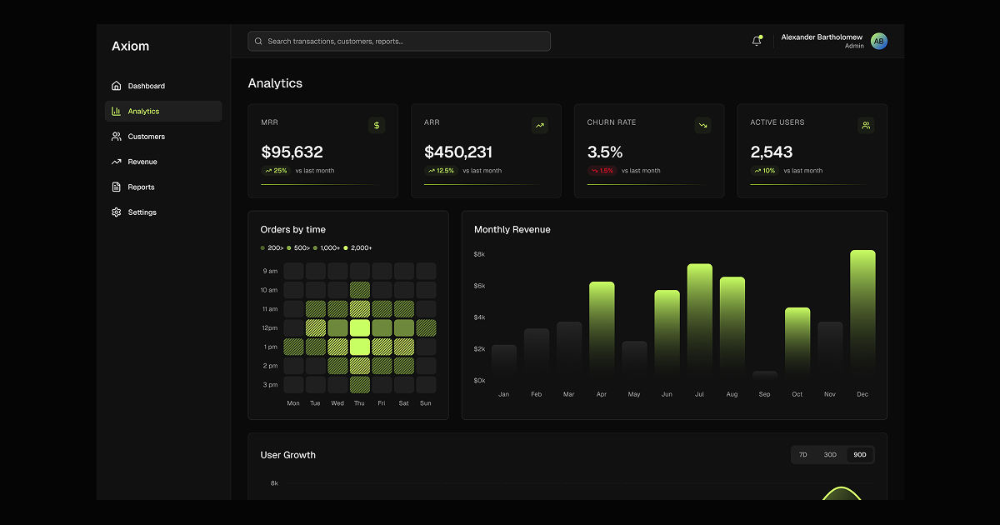

# Axiom

A dark SaaS dashboard UI kit, designed in Figma and built as a working prototype in plain HTML, CSS and JavaScript.

**[Open the prototype](https://sytnykk.github.io/axiom/)** · **[Browse the components](https://sytnykk.github.io/axiom/components.html)**

## What's here

- **Prototype** (`index.html`): four screens — Dashboard, Analytics, Customers and Settings. The charts respond to hover and to the period switch, the customer search and status filter work, and the settings toggles respond. The menu adapts to the screen: a sidebar on desktop, a row under the logo on tablets, and a burger once the items stop fitting.
- **Components** (`components.html`): the colour tokens, type scale, spacing and 15 components, each shown in its states with HTML you can copy. The swatch values are read from the live stylesheet, so the page always matches the code.

## How it was built

The design lives in Figma, on a fully tokenized Variables system. The screens were read into code with Claude through the Figma MCP server, so every colour, spacing and radius value in the CSS maps to a named Figma variable (for example `--bg-300` is `bg/300`).

Reading the file this way also surfaced gaps in it — raw hex values where a variable should be, a table header that differs between screens, a mismatched row count. Those are listed under *Build notes* on the components page, along with how the code resolves them.

Both pages are single self-contained files with no build step. Icons are from [Lucide](https://lucide.dev); the typeface is [Geist](https://vercel.com/font).

## Author

Oleksandr Sytnyk, product designer · [sytnyk.netlify.app](https://sytnyk.netlify.app) · [LinkedIn](https://www.linkedin.com/in/sytnykk/)
